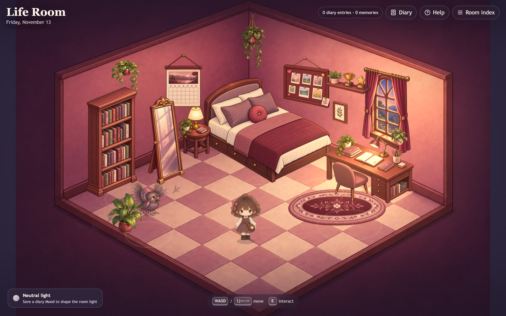
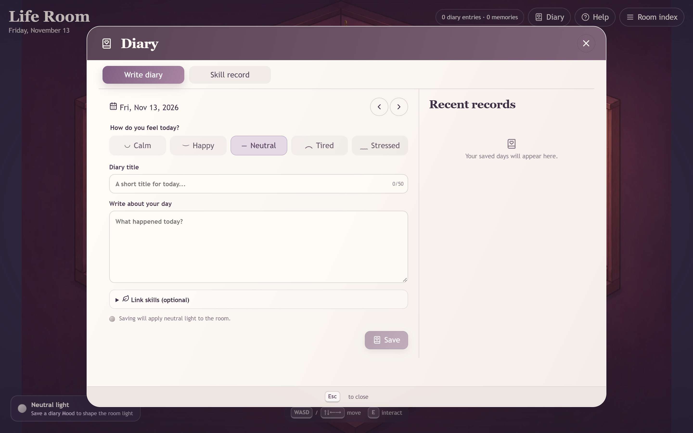
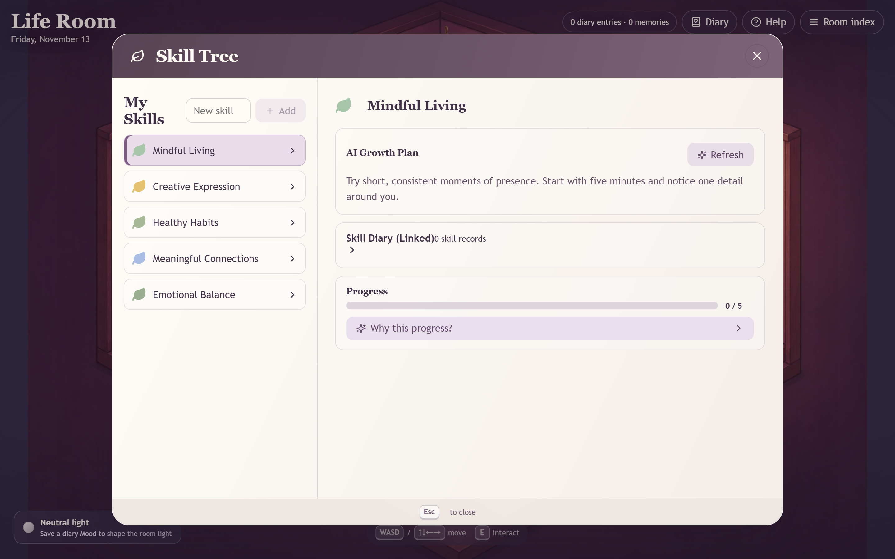
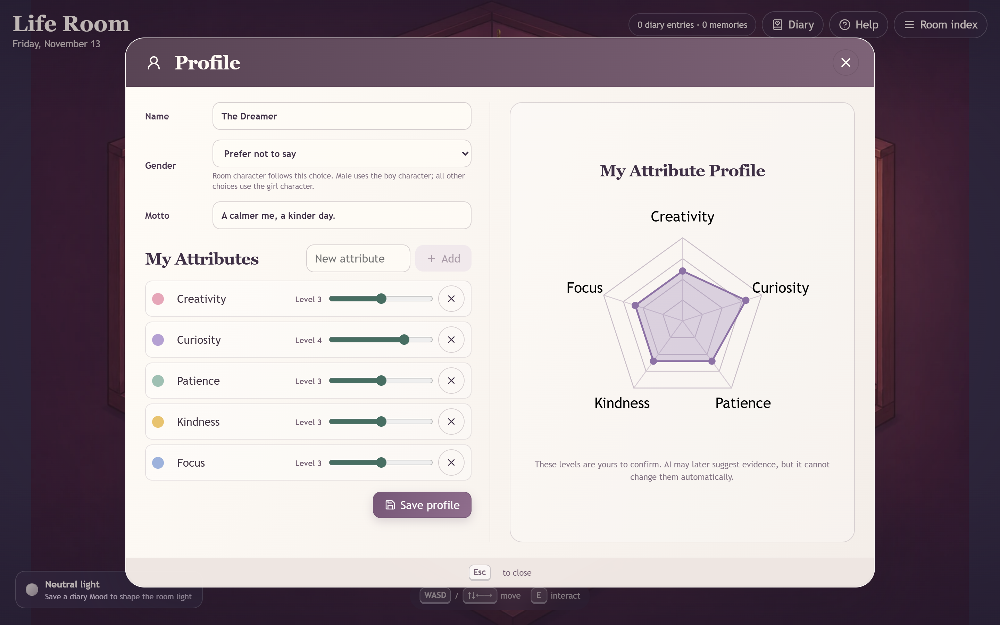
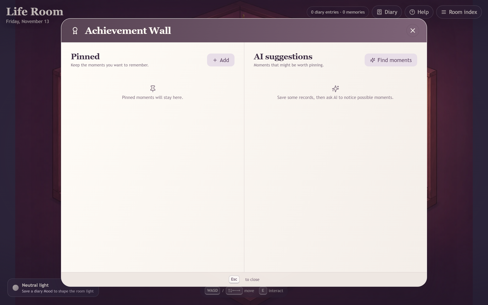
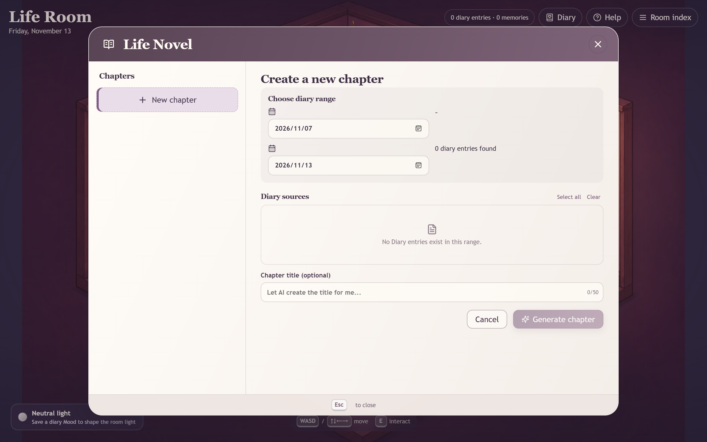
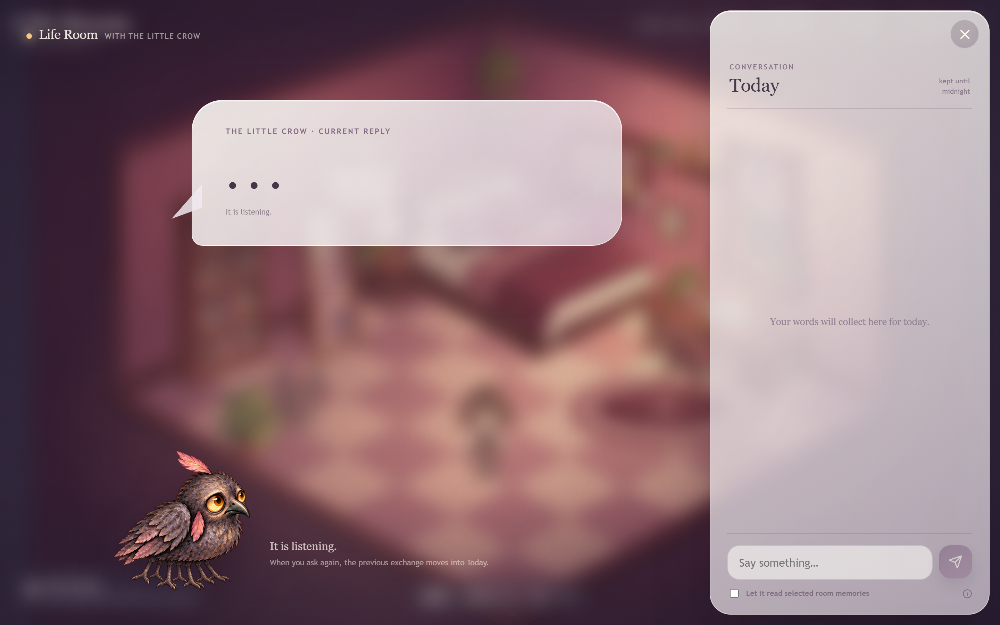
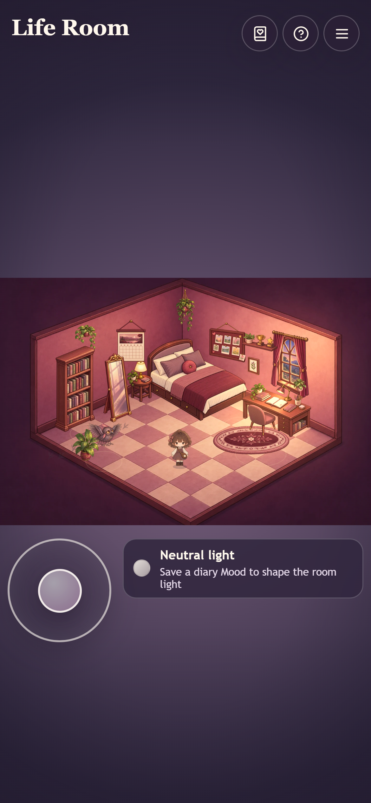

# Life Room

**Write a day. Save a moment. See your room respond.**

[Open the live preview](https://game-version-beta.vercel.app/) · [Read the development weblog](files/weblog-completed.md)

Life Room is a 2D web app for keeping a personal record of everyday life. You move a small character through a room and open different tools through its objects. A diary entry can change the room's light when you save it. Over time, the room becomes a place to revisit what you have done, learned, and chosen to remember.

The project asks: **How can a room and a gentle AI companion help people record, understand, and grow through everyday life?** The opening story places the player between two writers from different times. The Little Crow later becomes the AI companion. The player remains in control of what is saved, pinned, or used in a Life Novel chapter.



*Current desktop build. The room screenshot shows a fresh local record with neutral light.*

## What you can do

| Place | Function | What it does |
| --- | --- | --- |
| Bookshelf | Diary | Write and edit entries, choose a Mood, and save it to change the room light. |
| Plant | Skill Tree | Keep skills and practice records; see progress based on saved records. |
| Bed | Profile | Set your name and personal attributes. |
| Achievement wall | Achievements | Add and pin moments that matter to you; review AI suggestions separately. |
| Room | Life Novel | Choose diary sources, edit a draft, and approve a chapter yourself. |
| Little Crow | AI Companion | Ask for a short reflection. Sharing saved room records is optional. |

The six functions are also available through **Room index**, so you can open them without walking across the room.

## Preview

These are screenshots of all six function pages in the running `game-version` build. Click an image to open it at full size. They were captured with fresh local test records, so the pages may look empty.

| Diary | Skill Tree |
| :---: | :---: |
| [](files/weblog-assets/actual-diary-panel.png) | [](files/weblog-assets/actual-skill-tree-panel.png) |
| Profile | Achievement Wall |
| [](files/weblog-assets/actual-profile-panel.png) | [](files/weblog-assets/actual-achievement-wall-panel.png) |
| Life Novel | Little Crow AI Companion |
| [](files/weblog-assets/actual-life-novel-panel.png) | [](files/weblog-assets/actual-crow-companion-panel.png) |

<p align="center">
  
</p>

*Phone layout with a virtual joystick. You can also tap to move and use touch gestures to look around the room.*

## Run the current version

You can [try Life Room in your browser](https://game-version-beta.vercel.app/). To run it locally, you need Node.js and npm. The active app is in [`game-version/`](game-version/README.md).

```powershell
cd game-version
npm ci
npm run dev
```

Open [http://localhost:3001](http://localhost:3001). To check a production build, run `npm run build` and then `npm run start` from `game-version/`.

Use **WASD** or the arrow keys to move, **E** to interact, or click and tap objects. The Room index provides direct access to every function.

An OpenAI key is optional. Without one, the Little Crow gives local fallback replies. If you want model responses, set `OPENAI_API_KEY` in `game-version/.env.local`; keep the key on the server. Personal records are stored in the current browser. They are not shared between devices.

## AI disclosure

- **Project work:** I used AI tools, including Codex, to help draft documents and build parts of the prototype. I chose the research direction, the room metaphor, the six-function scope, the opening story, and the final design decisions. I reviewed and revised the outputs and tested the working app.
- **Visual assets:** Some room, character, Little Crow, and early UI concept art was generated or refined with AI tools. I selected, adjusted, and placed these assets in the project. The previews above are screenshots of the running app, not generated mockups.
- **AI inside the app:** When a server-side OpenAI key is configured, the Little Crow can produce short replies, and the app can request draft text or suggestions. Without a key, local fallback responses are used. The user chooses the Diary Mood, decides which achievements to pin, and reviews Life Novel drafts before approval. The Crow reads saved room records only when the user turns that option on.

## Project notes

- [Current app and setup](game-version/README.md)
- [Game-version requirements](game-version/basics/PRD_g.md)
- [Iteration log](game-version/documents/13_Iteration_Log.md)
- [Development weblog — dated decisions and my contributions](files/weblog-completed.md)

`room-version/` is an earlier prototype. `game-version/` is the current project.
