# Life Room Weblog

## Description
1/8/2026

The project, titled “Life Novel,” is a self-management tool featuring a role-playing game (RPG) style and an AI companion in a talking Mirror. It is designed to allow users to visually track their personal growth. The AI is incorporated to assess skills, set plans and goals, and help users manage stress. Features included in the project’s design are to-do lists, a success journal, main quests, a skill tree, a calendar, character profiles, AI guidance through the Mirror, and the “Life Novel.” Based on users’ daily entries, a monthly novel is generated each week, weaving the tranquility of everyday life into a story.

30/8/2026

The project called life room displays the mood and state of the users. Initially, it was designed as a self-management tool but changed the direction into a space to reflect the daily life of users. As the diary users input, the atmosphere of the room will change. To make the project more game like, the introduction section is designed as puzzle game, but after experiencing the game, users' own life just begin.

## Development record

### 4 July 2026 — My first research question

My initial research question: “How can structured LLM-driven narrative systems balance player freedom with coherent story progression and meaningful endings in interactive games?”   
I looked at AI Dungeon as a text adventure. It showed me that AI can keep a story moving after many different player choices. I then asked another question: could AI affect the visual world of a game, rather than only produce text? This was still a game-narrative question. 

**My contribution:** I set the first research direction and identified the gap between generated text and a visible game world.

### 10 July 2026 — Why games show progress so well

I began to connect self-management and games together. I thought about why level-ups and progress bars in game can feel rewarding. The slow growth of real skills often make people disappointed, and people may ignore their own progress.  
The “Earth Online” idea helped me connect game feedback with everyday life. My working question became: **Could a game-like tool help people notice progress in real life?**

**My contribution:** I moved the idea from interactive fiction toward personal growth and self-management.

### 11 July 2026 — Comparison table

I tried Habitica, Finch, and Habit Hunter. I made a table of what each app did well and what I thought was missing for my idea.
| Project | Advantage | Disadvantage |
| ----------- | :-----------:| :-----------: |
| Habitica | Obtain EXP from users' record to buy stuff | Easy to gain EXP by cheating |
| Finch | Introduce pets as the motivation of people | No long term quest |
| Habit Hunter | More adventure game like | Weak connection between game and real life |

Habitica gave quick rewards for tasks. Finch showed how a companion could make an app feel warm. Habit Hunter gave tasks an adventure style. However, task systems could be “easy to cheat.” I would describe the problem more carefully now: a check mark does not show how hard an action was or why it mattered. I did not know whether users of those apps cheated.The introduction of AI guidance can be a solution. The difference between the existing application and my idea supposes to be the life novel generator and the AI accompanion.
The table helped me choose two features to investigate: an AI companion and a story made from the user's own life records. The research question shifted again: **How could a system connect visible progress with real experience and personal meaning?**

**My contribution:** I chose comparison criteria and used it to define how my project might differ.

### 14 July 2026 — Reading about related reference

Looking for the reference...

[2005 Establishing and Maintaining Long-Term Human-Computer Relationships](https://www.media.mit.edu/publications/establishing-and-maintaining-long-term-human-computer-relationships)

[2025 Characterizing Relationships with Companion and Assistant Large Language Models](https://dl.acm.org/doi/10.1145/3715070.3749245)

[2026 Beyond Human Bonds: Understanding Relationship Development with Humanized AI Companions](https://stars.library.ucf.edu/hmc/vol13/iss1/7/)

Replike as ai companionship reference

I collected research on long-term relationships with computer agents and newer AI companions. I wanted to understand whether an AI character could feel like a steady presence. Reading also made me think about the limits of this kind of relationship.

**My contribution:** I connected the ai companion idea to research.

### 20 July 2026 — Searching for a visual direction

I looked for visual references and refined the list of functions. I wanted the project to feel like a place someone could return to, rather than a standard productivity page. At this stage, the appearance was still an open design problem.

| Room element | Product function | Purpose |
| --- | --- | --- |
| **Room** | **Life Novel / Home** | The main interface and the cumulative visual record of the user's life. Opens the Life Novel overview and its chapters. |
| **Bookshelf** | **Success Diary** | Records completed actions, small victories, reflections, and meaningful moments. |
| **Vision board** | **Main Quest** | Shows the user's most important long-term goals and their progress. |
| **Desk** | **To-do List** | Creates, organizes, schedules, completes, postpones, or archives practical actions. |
| **Mirror** | **AI Guidance** | A storybook-inspired talking mirror through which the dream's AI friend and observer speaks with the user. |
| **Plant** | **Skill Tree** | Represents skills and learning paths; visible plant growth reflects confirmed progress. |
| **Bed** | **Character / Hero** | Represents the dreamer and opens the user's identity, avatar, profile, current themes, strengths, and growth summary. |
| **Calendar** | **Calendar** | Displays events, dated tasks, milestones, and completed records by day. |
| **Achievement wall** | **Achievement Wall** | Displays confirmed milestones, memories, awards, and important life moments. |

**My contribution:** I worked on the project's visual direction and narrowed the early feature ideas.

#insert_inspiration_picture_here

*The original July inspiration image is still missing.*

### 31 July 2026 — First repository record

I think the talking Mirror could act like an NPC who guides a player at the start of an RPG, or like a friend in Habit Hunter. This made AI companionship part of the product's character, rather than a background feature. I built my repository and push my first commit today.

**My contribution:** I gave the AI guide a clear role in the game idea and began saving the project in a repository.

### 1 August 2026 — First demo

I run the first demo. The concept, called Life Novel or Life Book, put RPG-style self-management functions into a website: tasks, a success diary, main quests, skills, a calendar, a character profile, AI guidance through the Mirror, and a Life Novel. I imagined AI turning daily records into a regular personal story.

The demo made the concept visible. It also helped me notice that a page full of functions might still feel like a normal tool. I have not yet solved how a person's everyday life would become a meaningful experience in the app.

**My contribution:** I turned the idea into a first demo and used that demo to test the shape of the concept.

#insert_first_demo_picture

*The original first-demo screenshot is still missing.*

### 4 August 2026 — I chose a web-based PWA

I tried making a 3D version in Unity, but the greybox did not give me the experience I wanted. I also thought ahead to user testing: a web app would be easier to share with friends because they could open a link without installing the game.

I decided to build a Progressive Web App (PWA) instead. I wrote a Markdown PRD and a clear build prompt for Codex, covering the functions I had planned. This turned the idea into a practical plan for the first prototype.

**My contribution:** I tested the Unity direction, chose the PWA format for easier user testing, and defined the scope of the first build.
#insert_link_prd

[PWA room MVP PRD](../room-version/documents/01_PRD_MVP.md) — the version kept in this repository with the August room prototype.

#insert_picture

*The original Unity greybox and 4 August demo screenshots are not in this repository yet.*

### 7 August 2026 — Rethinking the first interface

I needed to rethink the project's visual expression. The first website made the functions easy to list, but it did not create much sense of entering a world. My question is how to make the experience more immersive. A room seemed more promising because its objects and atmosphere could hold memories.

**My contribution:** I identified a weakness in the first demo and chose a new spatial design direction.

### 14 August 2026 — The first room MVP

Today I have a working 2D room. A character can move around and open nine functions through furniture. The Desk opens tasks, the Bookshelf opens the Success Diary, the Plant opens the Skill Tree, the Bed opens the Hero profile, and the Mirror opens AI Guidance. I have made a furniture-to-function table, a user journey, a data model, and acceptance criteria to keep these parts connected.
#insert_link

[Furniture-to-function mapping and MVP requirements](../room-version/documents/01_PRD_MVP.md) · [User journey](../room-version/documents/02_User_Journey.md) · [Data model](../room-version/documents/04_Data_Model.md) · [Acceptance criteria](../room-version/documents/06_Acceptance_Criteria.md)

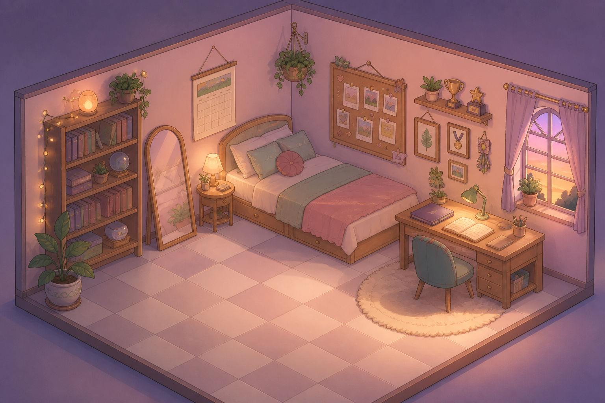

*The single room image used by the early room prototype. Furniture was still part of one background image.*

The room uses Phaser for movement and React panels for writing and editing. Calendar, Desk, and Bookshelf share the same task and Diary records. I want an edit in one function can appear everywhere.

I do not want energy bars, combat, or penalties for unfinished tasks. The aim is to help people notice their lives, not make a difficult day look like failure. I now need to find out whether new users understand the furniture and want to return to this room.

**My contribution:** I designed the room metaphor, mapped furniture to functions, and built the first connected prototype.

### 26 August 2026 — Too many inputs, too little to see

I am worried about the direction of the project. I spent a lot of effort building functions, but the result still feels more like a tool than a creative experience. There are many things to enter and too little visible response. What can one small input change in the room?

I consider making the project mainly a Diary that changes a personal room. That could give a much clearer link between input and output. But I do not want to remove AI guidance through the Mirror, which has been important since the beginning. I also think about a larger mystery that people could discover over time. I cannot expect AI to create a fitting personal world for every new user when it knows nothing about them yet.

One possible answer is to keep the opening story authored and let the user's own records shape the later experience. I am also listing problems to investigate: slow panels, keyboard controls interfering with typing, saving data on every keystroke, and how to study the whole process of recording, reflecting, and acting. I need to test more than whether every button opens.

**My contribution:** I identified the weak input-to-output link and set a clearer direction for the next version.

### 30 August 2026 — A room that responds to a saved day

I am reducing the main functions from nine to six: Diary, AI Guidance through the Mirror, Skill Tree, Achievement Wall, Profile, and Life Novel. I have written a new PRD with a six-function table and a Mood-to-light table.

| Room element | Product function | Purpose |
| --- | --- | --- |
| **Room** | **Life Novel / Home** | The main interface and the cumulative visual record of the user's life. Opens the Life Novel overview and its chapters. |
| **Bookshelf** | **Diary / Skill Record** | Records moods, reflections, meaningful moments, and evidence of skill practice. |
| **Mirror** | **AI Guidance** | The talking mirror gives the user AI guidance and a place to reflect. |
| **Plant** | **Skill Tree** | Represents skills and learning paths; visible plant growth reflects confirmed progress. |
| **Bed** | **Profile** | Represents the dreamer and opens the user's identity, avatar, motto, attributes, and growth summary. |
| **Achievement wall** | **Achievement Wall** | Displays confirmed milestones, memories, awards, and important life moments. |

The main action is now clear: write a Diary entry, choose a Mood, save it, and watch the room light change. The user chooses the Mood. AI does not decide how the user feels. A tired or stressful day is still a valid day to record. It is not a low score.

I want to let user feel the experience more like a small game, and their real life should become the continuing story after ending of game. I still need to test how the visual change feels to people.

**My contribution:** I reduced the scope, wrote the six-function and Mood tables, and defined the Diary-to-room loop.

#insert_mood_room_picture

*A screenshot showing the room before and after saving a Diary Mood is still missing.*

### 4 September 2026 — What is the story of the introductory part?

I am designing a secret from the player's perspective. Two unseen writers leave conflicting warnings on the notes. One says not to look at the window, the other says not to trust the first writer. I want the room to feel mysterious, even a little frightening, before the player understands what is happening.

Actually, it will be a story about three time line persons who lived, is living or will live in this room interact and communicate with each other. The unseen writers are the past resident and the future resident. They realised the situation earlier than users who is living in the room, so they want to kid the middle one.

I do not want to explain the three time periods at the start. The player should first notice clues, move around the room, and form their own ideas. The past and future connection can come later.

**My contribution:** I set the background of the introductory game.

### 7 September 2026 — Turning the story into a game flow

I’m currently researching exactly what players do during the opening stages. Each narrative node should guide players to take action within a room, learn a specific way to interact, or shift their perspective. I want the puzzles to lead players to discover the real diary and other features, without turning into a long list of instructions.

**My contribution:** I turned the mystery idea into a sequence of clues and player actions.

#insert_background_document_link

[Background and opening guidance](../game-version/basics/background.md) — a later written version of the story direction, updated on 18 October.

### 12 September 2026 — The first playable introduction

The opening scene now takes place inside a room. The player will find an envelope bearing two different handwritings, walk over to the window, use the bug net in a short, fail-safe sequence of actions, spot a strange little creature, and uncover the truth. The story is guided by the player’s actions as they move and interact with the environment.

I’ve kept the plot progression separate from the player’s personal journal. Replaying the opening sequence should not delete journal entries or alter the saved state of the room. The sticky notes, handwritten text, a leaf, a net, the creature, and the room’s visual effects all come together to form the story’s visual language.

But my concern is whether players will understand that this puzzle is merely the opening, and that the room’s true purpose is to record their own daily lives.

**My contribution:** I built the opening and linked its story steps to the real room and Diary.

#insert_intro_gameplay_picture

*A screenshot of the September playable opening is still missing. [Opening note art](../game-version/public/onboarding/notes/note-paper-a.png) and [net animation art](../game-version/public/onboarding/objects/net-sweep-8f.webp) are available as separate project assets.*

### 18 September 2026 — What needs to improve next?

After trying the playable opening, I am making a list of the changes I want to move on:

- **Room background:** It still looks too flat. I want separate layers, better light, and more detail so the room can visibly respond to a saved day.
- **Player character:** The character does not match the detail of the room. I want clearer art and smoother movement.
- **Little Crow:** The creature needs a stronger shape and better animation. It should feel strange in the mystery. I have not decided its role after the opening yet.
- **Function pages:** The panels still look like normal web forms. I want each page to feel connected to its room object and make its main action clear.
- **Opening story:** The clues, ending, and move from fiction to personal records need more work.
- **First-use guidance:** Movement, interaction, and the next step after the opening need to be easier to understand.

This list gives me a direction for the next version. I want the story, room, and useful functions to feel like one experience.

**My contribution:** I listed the main visual, interaction, and story changes for the next version.

### 22 September 2026 — Asking friends what they think

I talked to friends about Life Room. I ask what they think of the room, the opening mystery, and the Little Crow as a story creature. I also want to know whether the idea makes sense after I explain what happens when the story ends. Can they see why someone would keep using the room to record daily life?

These conversations give me first reactions, not a full user study. They push me to explain the link between the game opening and the everyday tools more clearly. I also need a working version that friends can try, because describing the idea is different from watching someone use it.

**My contribution:** I sought early feedback and identified where my explanation of the project was unclear.

### 30 September 2026 — Which AI model should power the Mirror?

I compare AI services and language models for the talking Mirror. My list includes GPT through the OpenAI API, Claude through Anthropic, Gemini through Google, DeepSeek, and open models such as Llama or Qwen through Ollama. I want to find a model that can sound warm and brief, fit the Mirror's role, and respond carefully to personal writing.

I am looking at response quality, cost, privacy, and whether friends can use the Mirror's AI through a shared link. A local model may give me more control, but I would need to keep my computer running for others to reach it. I have not chosen a model or provider yet. I need to try real conversations before deciding which option fits the project.

**My contribution:** I made a list of possible APIs and models and set the questions I will use to compare them.

### 8 October 2026 — Making the room art and interactions fit

I replaced the default furniture with a new furniture set and generated the first girl and boy character sheets. The small person represents the player, the one who lives between the past and future writers. I wanted a gentle traveller who would fit the warm room: soft brown hair, a cream top, olive trousers, and a small shoulder bag. I made walking frames from the front, back, and sides so the figure could move through the room. I still need to check its size without stretching the art.

The picture and the clickable area must agree. If the player clicks the Bookshelf, Diary should open. If they click the Mirror, the AI panel should open. The interaction marker should sit near the furniture rather than floating in an unrelated place. I am also exploring transparent movement sprites for the character.

**My contribution:** I defined the player's visual role, generated the first girl and boy movement art, and refined movement, collision, and furniture interaction areas.

  
  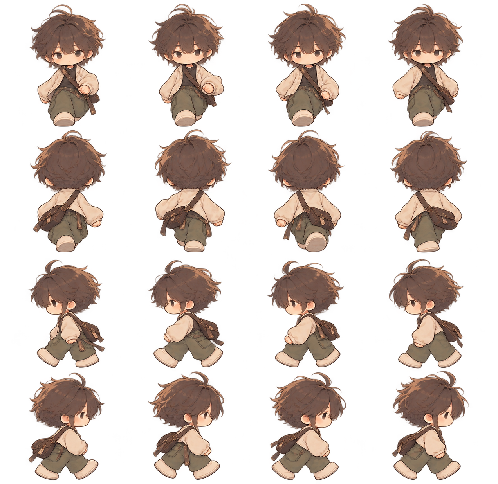

*These first character sheets were made on 8 October and committed with the new room art on 9 October.*

### 9 October 2026 — New room assets and layers

The new visual theme is in the project. I have room art, character art, separate furniture images, and a layered room build. I have written rules for the size and position of furniture images so new pieces fit the same room. Separating the objects from the background should make it easier to change the light, place clues, and replace an image without rebuilding the whole scene.

The room is becoming more flexible, but I still need to check whether all the art feels like one place and whether each object is easy to recognise and open.

**My contribution:** I prepared the new visual assets and set rules for placing furniture in the layered room.

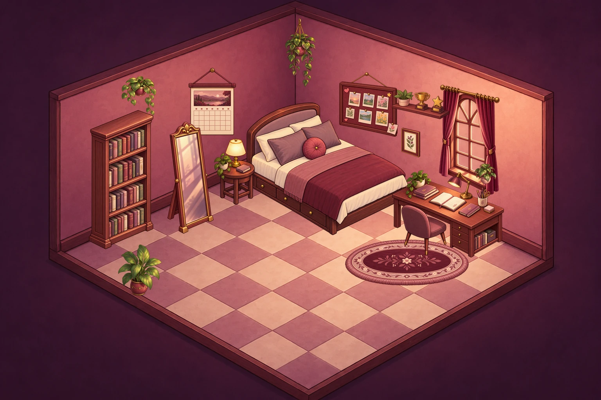

*Room layout preview from the new layered art set. [Furniture image rules](../game-version/basics/assets/room/FURNITURE_GENERATION_RULES.md).*

### 12 October 2026 — Clicks are opening the wrong pages

I checked the room in the local preview and finding interaction problems. Clicking near the Mirror can open Hero, but clicking the visible Bookshelf does not always open Diary.

I want the clickable area to match the visible, non-transparent part of each object. I am moving the interaction ellipses near the bottom of the furniture and asking for the Desk to open Life Novel. I also notice that character movement can feel laggy. Before making the UI more beautiful, the room needs to respond where the player expects it to.

**My contribution:** I tested the room, found mismatched hotspots, and specified how to correct them.

### 13 October 2026 — What belongs on each function page?

I redesigned the contents and the user flow of the six function pages. I want Diary to ask for **Mood** rather than weather. Profile should include a name, gender, motto, chosen attributes, and a radar view. Skill practice should connect to the plant. Diary entries should be possible sources for achievements and Life Novel chapters.

I also considered what the AI in the Mirror should do. It might suggest plans or recognise a meaningful moment, but I need to decide what the user should confirm. I still need to refine which ideas belong in the actual prototype. In the room, I keep adjusting labels and interaction markers so each page opens from the right object.

**My contribution:** I defined the main content and actions for each function page.

### 14 October 2026 — UI concepts and a possible friend test

I made landscape concepts for the function pages. Diary could look like book pages, Life Novel like an open book or scroll, and Achievement Wall like a pinboard. I considered how Mirror, Bed, and Plant pages could feel connected to their objects. If I later change the furniture art, I do not want to redesign every page from the beginning, so I also looked for a reusable page structure.

#concept_picture_of_each_function

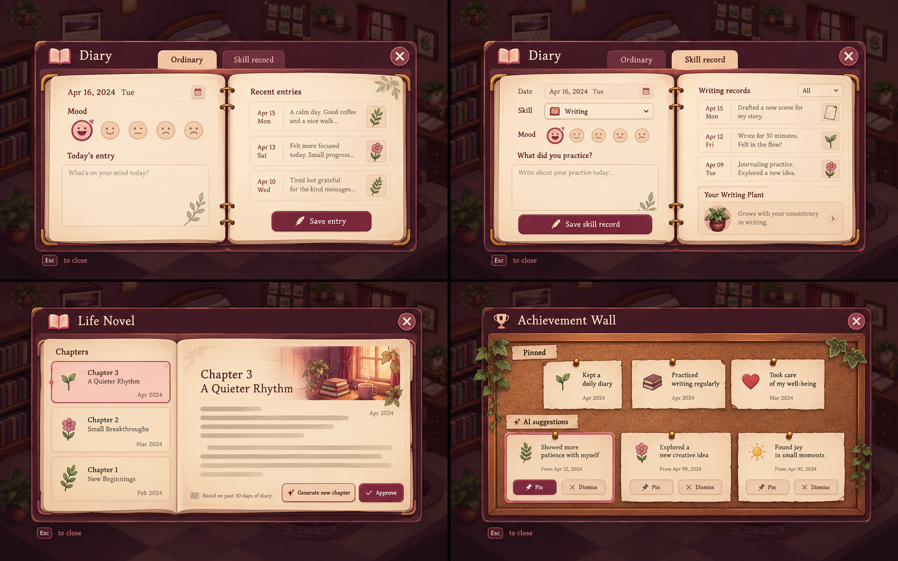

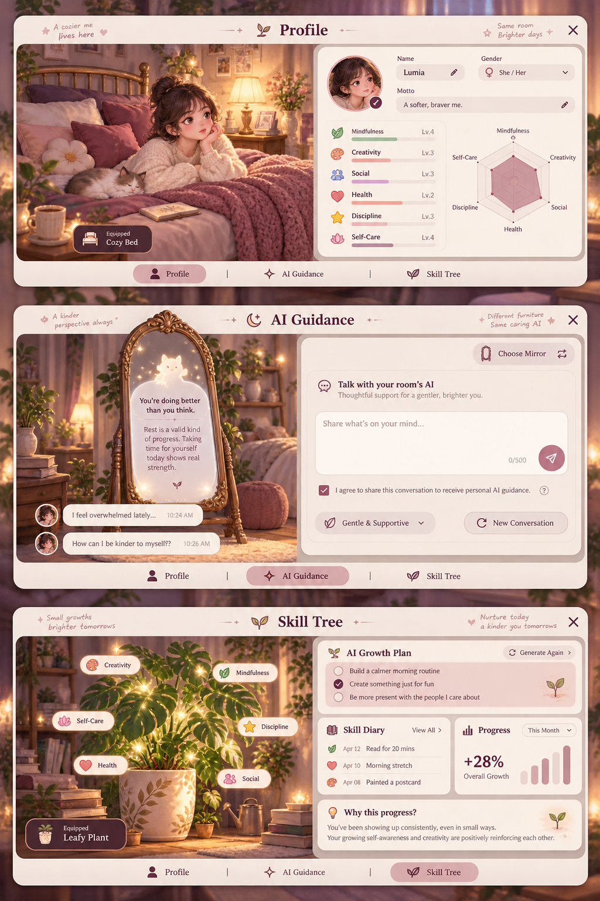

*These landscape images show the function-page design ideas, including AI Guidance in the Mirror. They are concepts, not screenshots of the working panels.*

I want friends to try the prototype and I asked what I would need for a short study of AI guidance through the Mirror. Could the Mirror help someone reflect, start a small action, or make a useful personal story? I considered a week of use, but first I need a version friends can reach and an AI reply that works reliably. I compared OpenAI with Ollama and considered how much it may cost to let several friends use the Mirror's AI.

#link_of_brief_questionnaire

[Related first-study plan and report](../game-version/documents/12_User_Test_Report.md). *The original brief questionnaire form or response file is not in this repository, so its direct link still needs to be added here.*

**My contribution:** I directed the object-inspired UI concepts and outlined questions for a friend test.

### 17 October 2026 — Rebuilding the function pages

I rebuilt the layout of the six function pages in warm ivory and muted plum. Each page now has a clear header, a close button, and a main action. The room remains visible behind the floating panel. The content changes with the object: Diary uses writing and recent records, Profile uses editable details and a radar view, and Life Novel separates chapter sources from the draft. These are working pages, not just the concepts I made on 14 October.

Diary now has date navigation, Mood choices, related Skills, recent entries, and a clear Save button. I added a Skill Record form for practice, duration, difficulty, and an optional Diary link. Skill Tree puts the skill list beside practice records and progress. The Achievement Wall separates moments I choose to pin from AI suggestions. Profile, AI Guidance, and Life Novel also need a clear purpose and main action.

The Life Novel now differs from my early idea of an automatic monthly story. The user now chooses dates and exact Diary sources, then reads and edits a draft before approving a chapter. Suggested achievements stay separate from achievements the user chooses to pin. I want AI to help write and reflect without deciding what becomes part of someone's lasting story.

I also started the more direct phone interaction work. A virtual joystick lets a phone user move the character. I have checked the panels and build locally. I still need to improve the phone camera and watch people use the pages to see what feels clear or confusing.

**My contribution:** I redesigned the six panels, clarified user approval, and began direct phone controls.

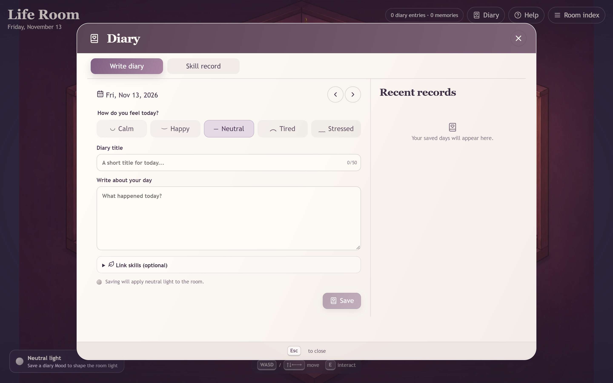

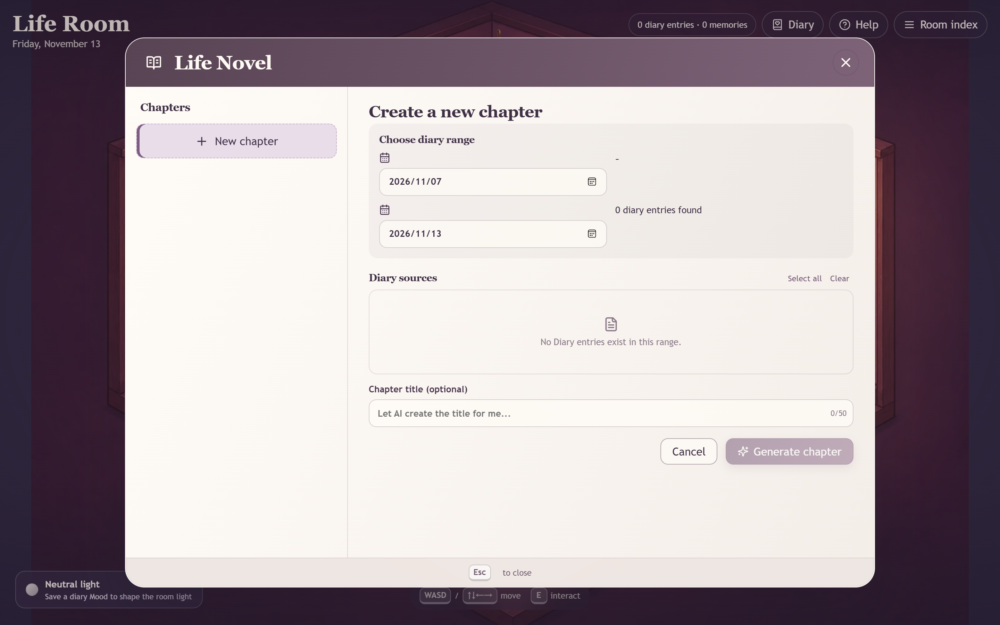

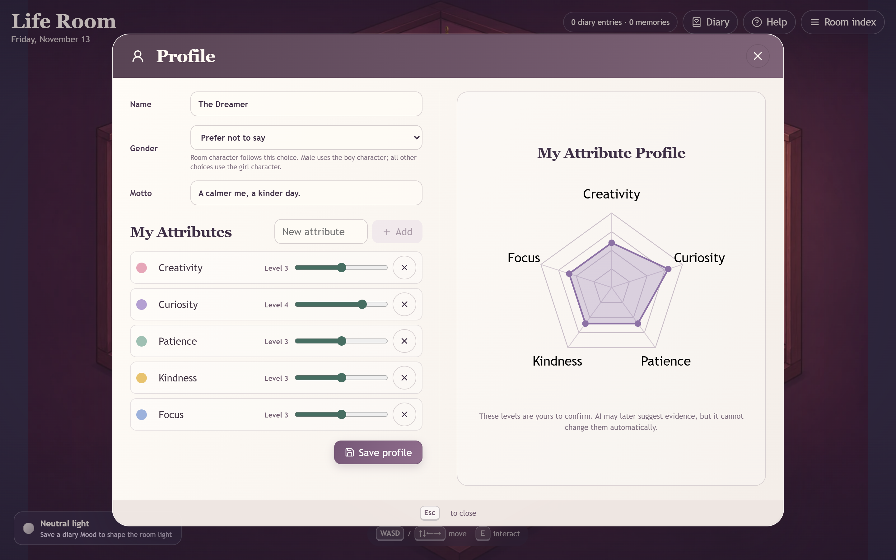

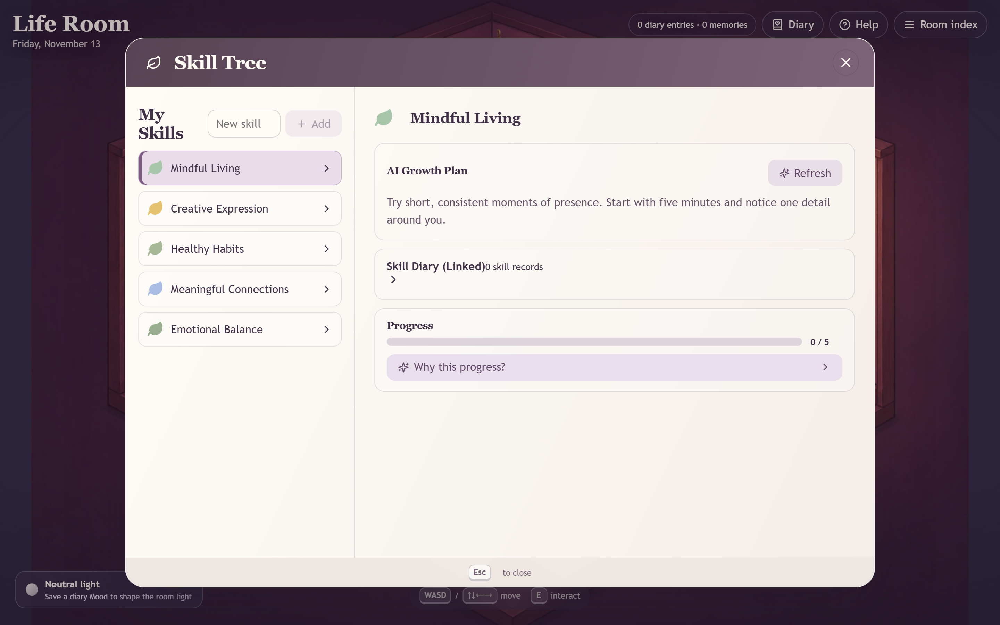

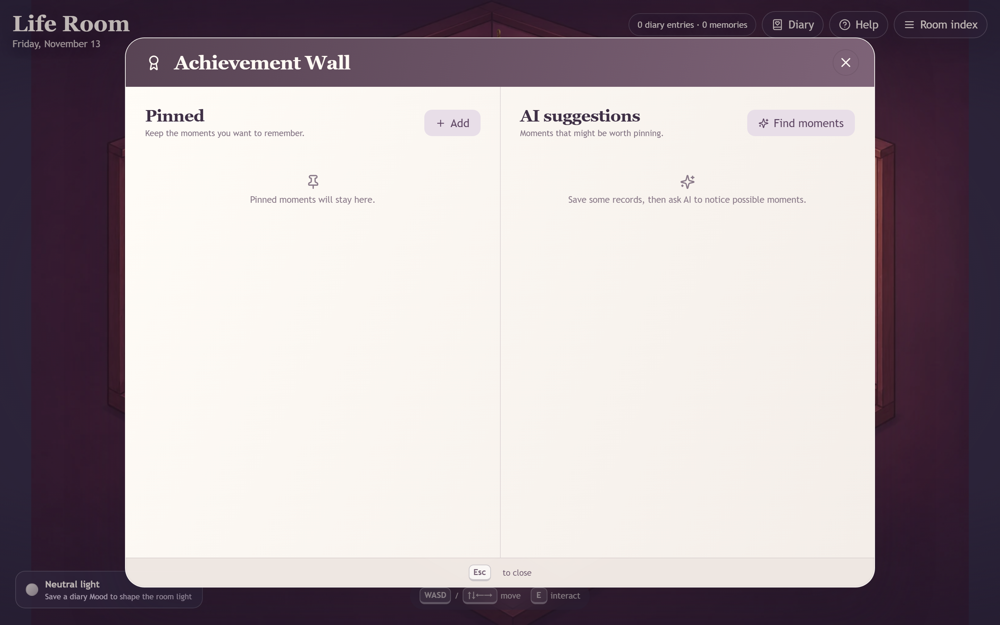

*These are real screenshots from the current project build, captured on 13 November 2026 with empty test records. They show the layout built from the 17 October redesign; they are not archived screenshots from that day.*

#mobile_picture

  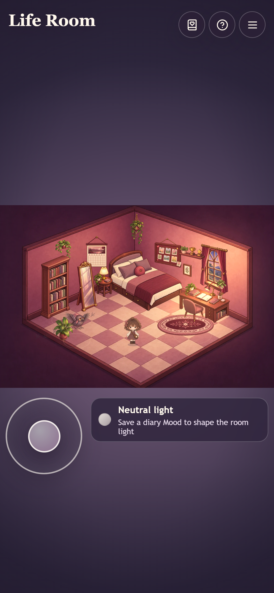

*This is a clear 1170 × 2532 screenshot of the current project build, used to show the phone controls. It is not an archived screenshot from 17 October.*

### 18 October 2026 — The Crow becomes the AI companion

I decided that the Little Crow would become the AI companion. Until today, AI Guidance belonged to the Mirror and the Crow was part of the opening story. I moved everyday AI conversation from the Mirror to the Crow. The Mirror stays in the mystery, while the Crow gets a larger conversation view. The Crow can read saved room information only when the user turns that option on.
#picture

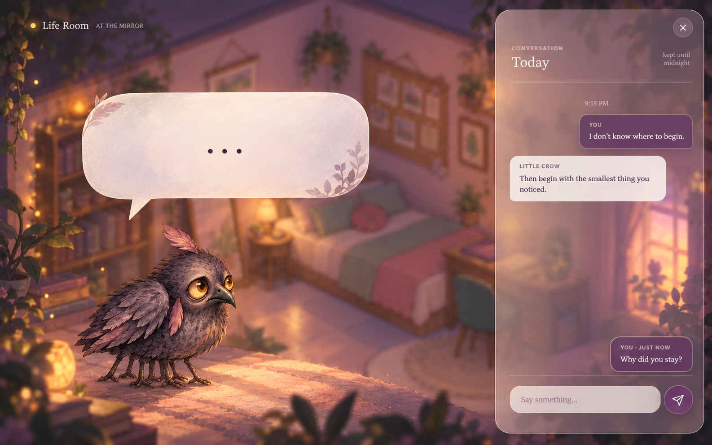

*Little Crow AI conversation concept saved with the 18 October design work. It is not a screenshot of a working conversation.*

I considered running Ollama on my own computer, but I cannot keep that computer on all the time. Friends would lose access to the Crow whenever it is off. I chose the OpenAI API for this web prototype and sent requests through a server route, so the key stays out of the browser.

I also made the opening story fuller. The two writers are connected to the past and future, while the player is “the one in the middle.” The number “Eight” leads to the Crow's eight legs. The opening now moves through Diary, Skill Tree, Profile, Achievement Wall, Life Novel, and Crow before the final reveal. Each story stop should teach a real action. Resetting the introduction must leave personal records alone.

**My contribution:** I redesigned the Crow, chose the OpenAI API setup, and expanded the opening story.

### 19 October 2026 — Refining the Crow and the opening

I made a second version of the player character as well as several versions of the eight-legged Crow. The girl now has a plum dress and hair bow; the boy has a brown vest and shorts. Both keep the soft brown hair and shoulder bag, so they still belong in the same room. The movement sheets show the front, back, and side views. I want the Crow's extra legs to seem plausible when the story reveals them, while it still looks like a companion. I also adjusted the room hints and guidance interface so players can find the next story object.

**My contribution:** I redesigned the girl and boy character art, iterated on the Crow, and improved the cues that lead players through the opening.

  
  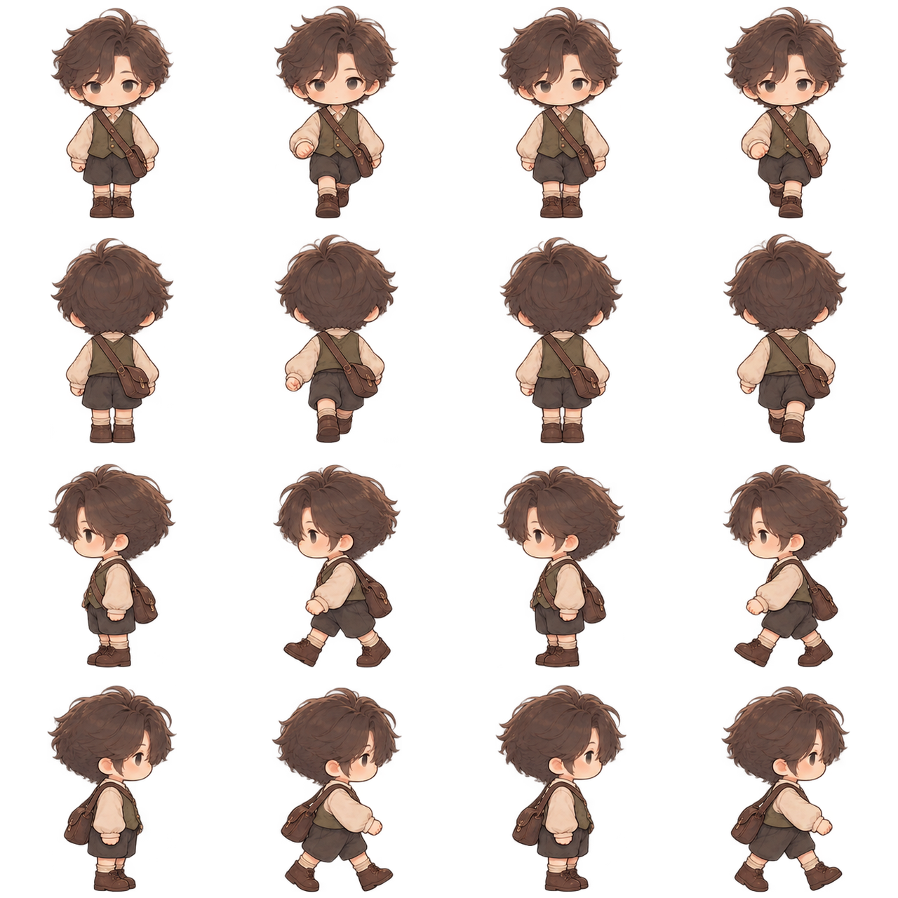

*The revised player-character sheets were added to the project on 19 October.*

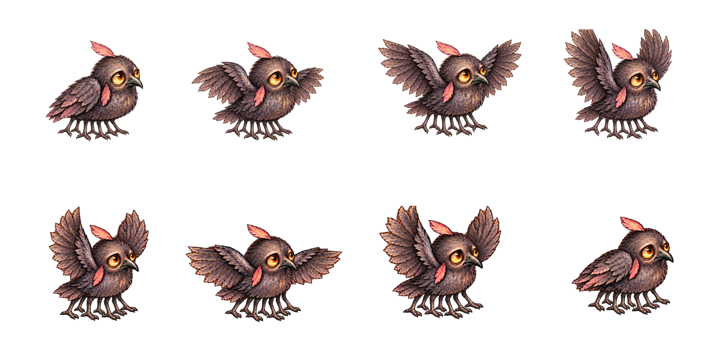

*The updated eight-legged Crow sprite sheet used for the opening.*

### 20 October 2026 — Improving phone navigation

I've developed the room camera and mobile control features. You can now click on interactive prompts. By pinching to zoom and dragging, you can more easily look around the zoomed-in room. I hope players without a keyboard will also be able to complete the opening section and use the room features.

**My contribution:** I refined touch interaction, camera movement, and help for phone users.

### 21 October 2026 — Checking the Vercel phone preview

I checked the website version on Vercel. Since it takes a long time to load, I had them lower the image quality and load the images in WebP format. It uses a faster mobile preview mode, but the room images are a bit blurry. I’d like the shared page to use a clearer version. Image quality is important because the room decor is part of the experience. I finally pinpointed the cause of the slow loading. It was because I had split the furniture into separate files, which required Vercel to make multiple requests. So I temporarily merged the background, which didn’t affect the hotspots.

**My contribution:** I checked the shared phone experience and identified the blurry preview as a visual problem.

[Phone preview showing the image-quality issue](../game-version/documents/mobile-preview-life-room.jpg) — the original 390 × 843 screenshot is kept as evidence of the problem.

### 21 October 2026 — The first survey answer

I received the first piece of feedback on this short survey. The respondent found the introduction somewhat valuable but noted that the article read like a puzzle. He tried all six features and liked the “Life Novel” concept. I hope these notes spark readers’ curiosity, but the next steps should still be easy to understand.

**My contribution:** I began gathering first-use feedback and identified a clarity issue in the opening text.

### 23 October 2026 — Rewriting the final reveal

I optimized the dialogue between the writer from the past and the writer from the future. The final paragraph of the opening section was too dense and too long, so I distributed this clue across three letters in the room. I moved the “Profile” closer to the bed so its purpose would be easier to understand.

I also confirmed that during the tutorial, the actual AI panel for “The Raven” pops up correctly. The story needs to maintain its own pace, but players must be able to connect each clue with the correct room action.

**My contribution:** I revised the dialogue, the three-letter reveal, and the links between clues and functions.

#insert_three_letter_reveal_picture

*A screenshot of the revised three-letter reveal is still missing.*

### 25 October 2026 — What the first feedback showed

I reviewed four more questionnaire answers. One person skipped the opening and could not find how to open the Crow. They also tried following it but did not get the response they expected. Another person said that saving a Diary entry and seeing the room change helped explain the product. A third felt that six functions were too many and preferred a simpler Diary-and-Crow experience. The fourth liked the clean Diary screen but worried about privacy and AI.

I want people to find the Crow and other functions even if they skip the story. Clear labels and direct access matter. I also want to keep the moment when a saved Diary entry changes the room, while making the first visit easier.

**My contribution:** I compared feedback on navigation, the room response, the number of functions, and AI privacy. I identified the need to make the Crow easier to find after a skipped opening.

### 27 October 2026 — Looking across the first responses

I reviewed six more questionnaire answers, bringing the total to 11. One person understood the link between Mood, Diary, AI chat, and a personal story, and liked Life Novel. Another liked the Crow but wanted richer media or more visible growth. A longer answer said the mystery notes were interesting but hard to follow, and that writing a full Diary entry at the start felt like too much. Someone else said the room change after a Diary entry made the idea clear. Another suggested showing a sample Diary entry so new players could see the whole process.

These answers make me think the opening needs clearer clues and a quicker way to record a small moment. The Crow and Life Novel attract interest, but most respondents have used the prototype only once. I can use their comments to improve the first visit. To understand continued use, I need people to return over time.

**My contribution:** I reviewed the first 11 responses, identified the need for clearer clues and a lighter first Diary step, and set questions for longer testing.

### 30 October 2026 — Sharpening the thesis question

I have completed the “Introduction” section of my thesis and reviewed the research literature on personal informatics, games, reflection, narrative, and AI companions. I need to identify a more specific research gap. I cannot claim that no other applications combine games with self-management. My question is: How do narrative, spatial elements, and AI companions work together in this specific design to support reflection?

**My contribution:** I connected the design to research and narrowed the claim my prototype can support.

### 5 November 2026 — Preparing to discuss the project

The submission deadline is approaching. Before meeting with my advisor again, I reviewed the 11 survey responses and outlined the next draft of my paper. Some people liked the room, the crow, and the story concept, while others were confused by the opening or found it difficult to write diary entries. I need to highlight these different reactions and avoid claiming that a single, brief survey of first-time users can prove long-term changes.

I also completed a self user test of the Crow and Life Novel. I used them in everyday situations and noted when they helped me reflect and when they felt difficult to use. My own experience can reveal design problems, but it cannot stand in for other users' experiences.

**My contribution:** I organised the survey findings, noted their limits, and completed a self user test of the Crow and Life Novel.

### 6 November 2026 — Keeping AI companionship in the research question

After consulting with my advisor, I hope to continue focusing on “AI companions” as the core of my research. I will draw on my personal experience using “Life Room” to explore this topic. I have interacted with “Crow” in my native language, Chinese, to share joyful moments, seek comfort when feeling stressed, and ask for help in starting a skill-building exercise. These experiences have made me realize that people’s motivations for using the same companion app can vary greatly.

I appreciate that “Crow” is both warm and concise, but when I simply want to share something, its questions can sometimes feel exhausting. The “Life Novel” feature also needs improvement: the generated content reads like outdated diary entries rather than a story in which I am the protagonist. I wonder if “Crow” would make this space more appealing if it had greater coherence, but I need to carefully consider issues of user consent and just how much information it should retain.

My current research question focuses on how AI companions can support reflective self-management through storytelling and spatial interaction.

**My contribution:** I kept AI companionship central and used my own experience to question the Crow and Life Novel designs.
