# Life Room Weblog

### 1 July 2026 — Starting

I want to make something for myself. I like chatting with AI, even when I am not looking for an answer to a particular question. I also wish I could see progress more clearly everyday. When I keep practising a skill, the changes are so gradual that I start to wonder whether I am getting anywhere. I find it difficult to motivate myself through that part. Could AI help me notice the small steps, or give me a push to continue?

### 4 July 2026 — My first research question

Today I wrote down a research question, “How can structured LLM-driven narrative systems balance player freedom with coherent story progression and meaningful endings in interactive games?” I looked at AI Dungeon. It can keep a text adventure going after many different choices. I wonder whether AI could change what a player sees in a game as well as what they read.

### 10 July 2026 — Visible progress

I keep thinking about how easy it is to notice progress in a game. A level goes up, a bar moves. With a real skill, I can practise for a while and still feel stuck. The “Earth Online” idea makes me wonder what a visible record of everyday effort might look like. Maybe I could bring some of that game feedback into the thing I am making.

### 11 July 2026 — Comparison table

I tried Habitica, Finch, and Habit Hunter and made a quick comparison.
| Project | Advantage | Disadvantage |
| ----------- | :-----------:| :-----------: |
| Habitica | Obtain EXP from users' record to buy stuff | Easy to gain EXP by cheating |
| Finch | Introduce pets as the motivation of people | No long term quest |
| Habit Hunter | More adventure game like | Weak connection between game and real life |

I wrote “easy to cheat” beside Habitica. A ticked box says very little about how hard something was or why I cared about it. I like the warmth of Finch's companion and the adventure feeling in Habit Hunter. I want my own records to add up to a personal story. I am also thinking about AI guidance, though I am unsure what it should decide.

### 14 July 2026 — Reading about AI companions

[2005 Establishing and Maintaining Long-Term Human-Computer Relationships](https://www.media.mit.edu/publications/establishing-and-maintaining-long-term-human-computer-relationships)

[2025 Characterizing Relationships with Companion and Assistant Large Language Models](https://dl.acm.org/doi/10.1145/3715070.3749245)

[2026 Beyond Human Bonds: Understanding Relationship Development with Humanized AI Companions](https://stars.library.ucf.edu/hmc/vol13/iss1/7/)

I also looked at Replika as an example of AI companionship. What makes an agent feel like a steady presence? What happens when someone begins to rely on it? I have more questions than answers.

### 20 July 2026 — Still looking for a form

I am collecting visual references and adding to the list of functions in my ideal tool. I can imagine tasks, long goals, skills, a success diary, and a personal story.

### 30 July 2026 — A long conversation with Chatgpt

I spent a long time [talking through the idea with GPT](https://chatgpt.com/share/6afd1b89-93bc-83e9-867a-37c27ef0368f) today. I began with a tool for myself, somewhere to record each day, write a success diary, and set monthly or weekly main quests. We went through possible formats and other apps. Habitica still feels too general to me. I want to follow a long goal or interest and see it changing over months.

Could AI assess skill progress against a standard the person chooses? I like the possibility, though I do not know how to make that judgement trustworthy. I also want AI to make a novel from things a person has really done and recorded. The conversation kept getting bigger, so I asked for the smallest version I could actually make. I want to keep the Life Book. I also like the idea of an AI character who guides the player at the start of an RPG.

Some suggestions sound too large or too much like a management tool, and I keep pushing back. I still need to work out what this will look like.

### 1 August 2026 — First demo

I ran the first website demo. I am calling it Life Novel or Life Book. It has tasks, a success diary, main quests, skills, a calendar, a character profile, an AI guide, and a place for the Life Novel. Lingling appears over the dashboard to introduce it. I can click around the idea at last, although the functions still feel separate. I want AI to turn daily records into a story, but I cannot feel that story in the demo yet.

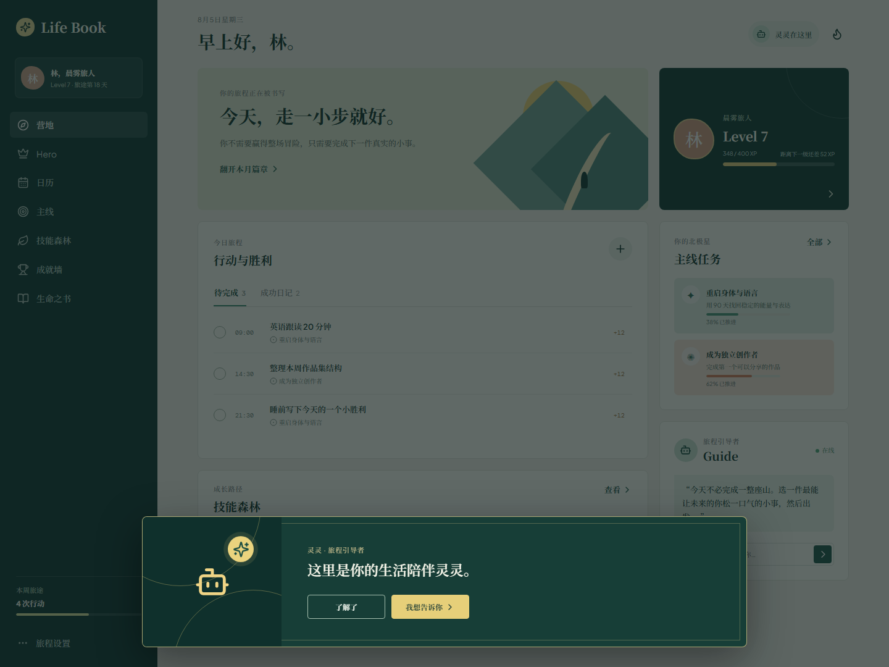

*The early web prototype looks just like a tool.*

### 4 August 2026 — I chose a web-based PWA

I tried a 3D greybox in Unity and looked at images of small rooms I might want to spend time in. The greybox does not feel right yet. I also want to share the project with friends, and asking them to open a link will be easier than asking them to install a game. I am going to make a Progressive Web App (PWA). I wrote a Markdown PRD and a build prompt for Codex to start on it.

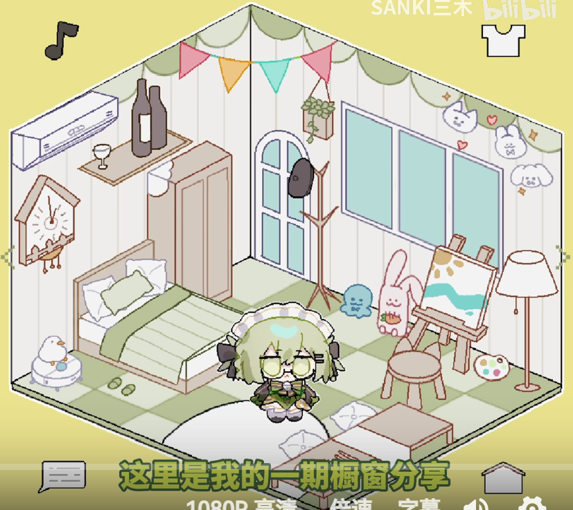

*A visual reference for the room experiments, it's from SANKI三木's video uploaded on bilibili.*

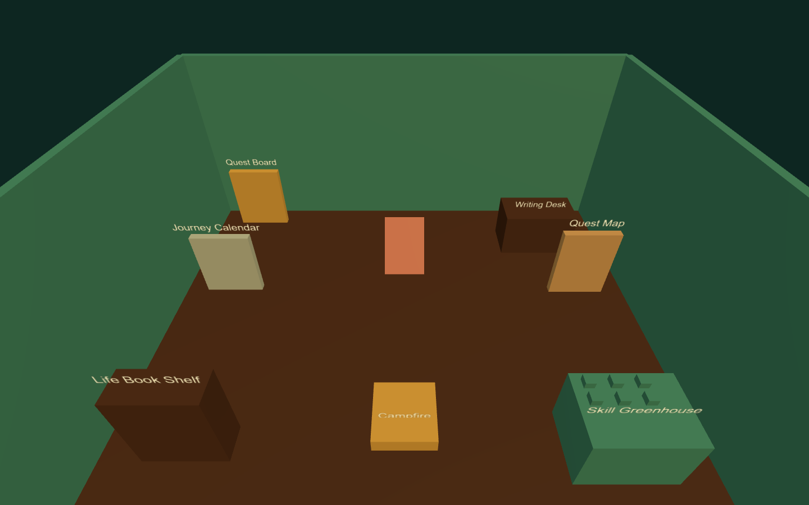

*The cabin greybox reconstructed in the Unity.*

[PWA room MVP PRD](../room-version/documents/01_PRD_MVP.md)

### 7 August 2026 — Rethinking the room

The first website is easy to navigate, but I do not feel like I am entering a world when I open it. I keep thinking about the room experiment. Objects could stay in familiar places, and perhaps the space could change with the person using it. I drew a quick version and gave the furniture jobs. I am already moving things around on the page.

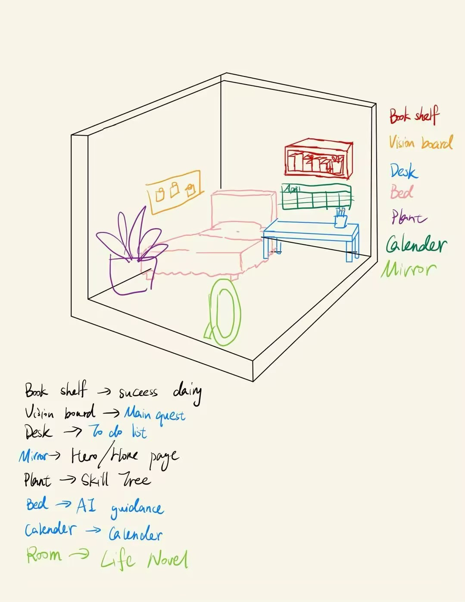

*My first room sketch. The Mirror opens the Hero page, and going to Bed leads to a dream where the player can talk with AI.*

I wrote out what each part of the sketch might open.

| Room element | Function | What I imagine there |
| --- | --- | --- |
| Bookshelf | Success Diary | A place to write down things I finished, small successes, and moments I want to remember. I want to be able to look back through earlier entries. |
| Vision board | Main Quest | The longer goal I am working toward, with smaller steps beneath it and a way to see how far I have come. |
| Desk | To-do List | The practical things I need to do today or soon. I could add a task, move it to another day, or mark it done here. |
| Mirror | Hero page / Home page | My character and personal profile, including who I am in this story, the attributes I choose, and a view of my progress. |
| Plant | Skill Tree | The skills I want to keep practising. Each skill could have its own path, and the plant might grow as I record real practice. |
| Bed | Dream / AI guidance | When I go to bed in the room, I enter a dream and talk with the AI guide. I could tell it about my day or ask for help when I feel stuck. |
| Calendar | Calendar | A way to revisit days, see tasks and milestones by date, and find the records I made on a particular day. |
| Room | Life Novel | The place that holds everything together. The days I record might gradually become a story I can return to. |

I am not sure whether every object needs its own page, or how much of this I can build in the first version.

### 14 August 2026 — The first room MVP

Today I have a working 2D room. A character can walk between pieces of furniture and open nine functions. I have changed two functions from the sketch. The Bed now opens the Hero profile, and the Mirror opens AI Guidance. The Desk opens tasks, the Bookshelf opens the Success Diary, and the Plant opens the Skill Tree. I made a furniture-to-function table, a user journey, a data model, and acceptance criteria while building it. I needed to remember what each object was supposed to do.
[Furniture-to-function mapping and MVP requirements](../room-version/documents/01_PRD_MVP.md) · [User journey](../room-version/documents/02_User_Journey.md) · [Data model](../room-version/documents/04_Data_Model.md) · [Acceptance criteria](../room-version/documents/06_Acceptance_Criteria.md)

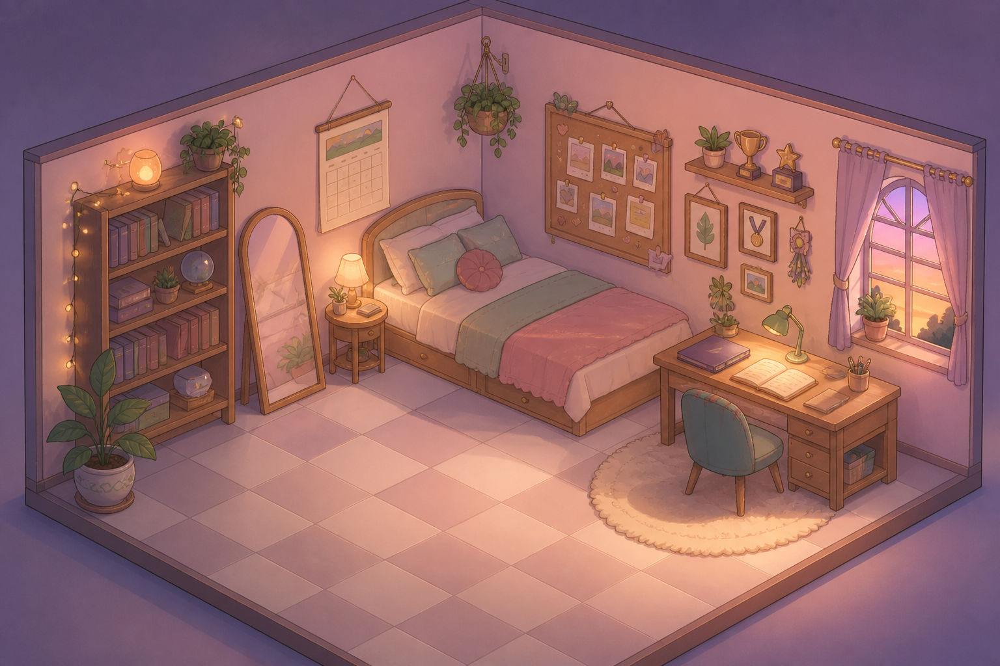

*The room is one background image for now.*

Phaser handles movement and React handles the writing panels. Calendar, Desk, and Bookshelf use the same task and Diary records, so an edit in one place can show up in another. I left out energy bars, combat, and penalties for unfinished tasks. When I have a difficult day, I do not want the room to make that feel like another failure. I still need to see whether anyone else understands where to click, or wants to come back.

### 26 August 2026 — Too many inputs, too little to see

I am worried about where this is going. I spent a lot of time building functions, yet using them mostly means filling things in. The room gives very little back. What would change if I entered just one thing about today?

I am considering a Diary that changes the room. I still want the Mirror's AI guidance, and I have been thinking about a mystery that people could slowly discover. I cannot ask AI to make a personal world for someone it has only just met. Perhaps the opening story needs to be written by me, with the person's records shaping what comes afterward.

There are smaller problems too, including slow panels, movement keys that interfere with typing, and saving on every keystroke. A button opening correctly tells me very little about whether recording a day helps someone reflect or act.

### 30 August 2026 — Light changes in the room

I cut the main functions from nine to six, including Diary, AI Guidance through the Mirror, Skill Tree, Achievement Wall, Profile, and Life Novel. I put them in a new PRD and made a Mood-to-light table. I wanted to see what a smaller room might do.

| Room element | Product function | Purpose |
| --- | --- | --- |
| **Room** | **Life Novel / Home** | The main interface and the cumulative visual record of the user's life. Opens the Life Novel overview and its chapters. |
| **Bookshelf** | **Diary / Skill Record** | Records moods, reflections, meaningful moments, and evidence of skill practice. |
| **Mirror** | **AI Guidance** | The talking mirror gives the user AI guidance and a place to reflect. |
| **Plant** | **Skill Tree** | Represents skills and learning paths, and visible plant growth reflects confirmed progress. |
| **Bed** | **Profile** | Represents the dreamer and opens the user's identity, avatar, motto, attributes, and growth summary. |
| **Achievement wall** | **Achievement Wall** | Displays confirmed milestones, memories, awards, and important life moments. |

The main action is now to write a Diary entry, choose a Mood, save it, and see the light change. The person chooses their own Mood, and AI does not tell them how they feel. I wanted tired or stressful days to have a place in the room too. I hope the opening feels like a small game, then makes room for what happens in someone's actual life. I have not watched anyone else try this change yet.

### 4 September 2026 — The story of the introduction

I have an idea for the room's opening. Two people have left notes in different handwriting. One warns the player away from the window, and the other says not to trust the first writer. I want the player to feel a little uneasy and go looking for an explanation.

The two writers are people who lived, or will live, in the room. The player is the person between them in time. The writers know something the player does not and are trying to lead them toward it. I would rather let the player find clues than explain the three timelines at the door.

### 7 September 2026 — Turning the story into a game flow

I am working out what the player actually does in the opening. A clue should give them a reason to move, touch something, or reconsider what they think is happening. The puzzles also need to lead them to the real Diary and the other functions. I do not want the beginning to feel like a tour of buttons.

### 12 September 2026 — The first playable introduction

The first playable opening is in the room now. The player finds an envelope with two handwritings, goes to the window, uses a bug net in a short sequence that cannot fail permanently, and spots a strange creature. I have been placing notes, a leaf, the net, and small visual effects where the player can discover them by moving around.

The opening has its own state. Replaying it should leave personal Diary entries and the saved room alone. I am less certain about the handover at the end. Will someone understand that the puzzle was an introduction and that the room is meant for recording their own days?

### 18 September 2026 — Improvement

After trying the opening, a few things keep bothering me.

- **Room background:** It still looks too flat. I want separate layers, better light, and more detail so the room can visibly respond to a saved day.
- **Player character:** The character does not match the detail of the room. I want clearer art and smoother movement.
- **Little Crow:** The creature needs a stronger shape and better animation. It should feel strange in the mystery. I have not decided its role after the opening yet.
- **Function pages:** The panels still look like normal web forms. I want each page to feel connected to its room object and make its main action clear.
- **Opening story:** The clues, ending, and move from fiction to personal records need more work.
- **First-use guidance:** Movement, interaction, and the next step after the opening need to be easier to understand.

I can feel the gaps between the story, the room, and the pages that open from it. I want to work on those gaps next.

### 22 September 2026 — Draft feedback from friends

I described Life Room to a few friends and asked about the mystery, the Crow, and what they thought would happen after the opening. I kept having to explain why someone would return to record an ordinary day. That may be a problem with my explanation, or with the experience itself. I need friends to try a working version so I can see where they hesitate without me talking them through it.

### 30 September 2026 — Which AI model should power the Mirror?

I made a list of text-generating LLMs that might power the Mirror, including GPT through the OpenAI API, Claude, Gemini, DeepSeek, and open models such as Llama or Qwen through Ollama. I want replies that are warm and brief, especially when someone writes about a difficult day. I am looking at cost and privacy too, along with whether friends could use it through a shared link. Running a model on my own computer sounds appealing until I imagine having to keep that computer on whenever someone wants to talk. I have not chosen a provider yet, and I still need to hear how the replies sound in real conversations.

### 8 October 2026 — Making the room art and interactions fit

I replaced the default furniture and made the first movement sheets for a girl and a boy. This small traveller is the player, the person between the past and future writers. I tried soft brown hair, a cream top, olive trousers, and a shoulder bag to fit the room's warmth. The sheets have front, back, and side walking frames. I still need to make sure the character looks right at game size.

The interactions are more troublesome than I expected. Clicking a visible Bookshelf should open Diary, and the Mirror should open AI Guidance. I am adjusting movement sprites, collisions, and the markers near each object so the clickable places make sense.

  
  

*The first movement sheets for the girl and boy characters.*

### 9 October 2026 — New room assets and layers

I committed new art today, with room, character, and furniture images on separate layers. I wrote size and placement rules for furniture because each new piece has to fit the same room. Layers should let me change the light, add clues, or replace an object without rebuilding the background. I still have to look at everything together. Some pieces may be hard to recognise or click.

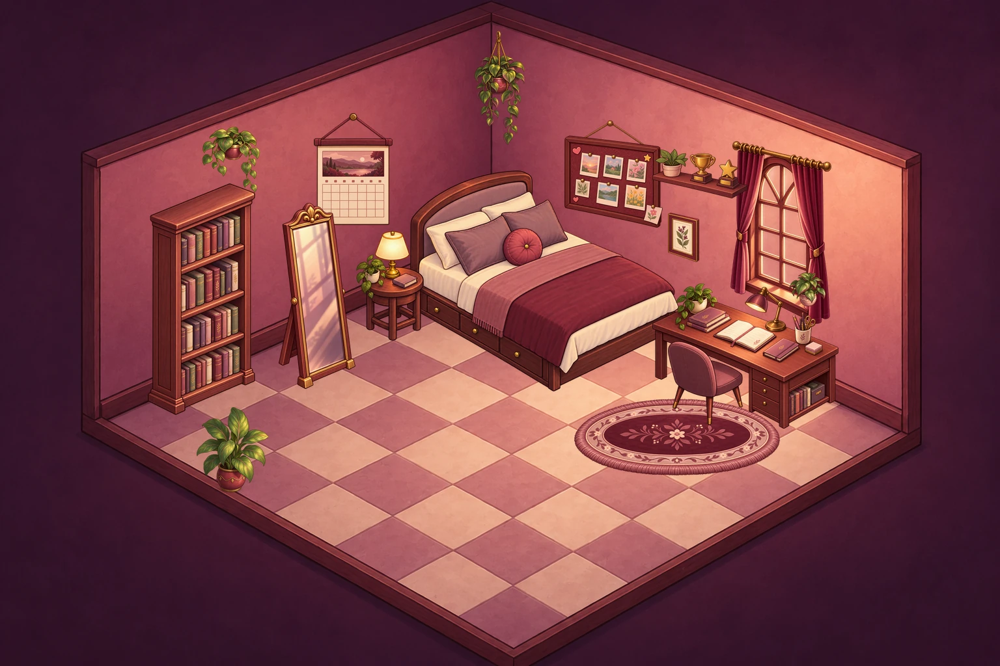

*Room layout preview from the new layered art set. [Furniture image rules](../game-version/basics/assets/room/FURNITURE_GENERATION_RULES.md).*

### 12 October 2026 — Clicks are opening the wrong pages

In the local preview, clicking near the Mirror sometimes opens Hero. Clicking the visible Bookshelf does not always open Diary. I am moving the interaction ellipses closer to the furniture and matching them to the visible parts of each image. I also want the Desk to open Life Novel. Movement feels laggy in places. These small mismatches make the room feel unreliable very quickly.

### 13 October 2026 — What belongs on each function page?

I went through the six pages again. Diary should ask for Mood rather than weather. Profile needs a name, gender, motto, chosen attributes, and a radar view. Practice records belong near the plant, and Diary entries might feed achievements and Life Novel chapters. The Mirror could suggest a plan or point out a meaningful moment, though I have not decided which suggestions the person should confirm before they become part of their record. I am still changing the room's labels and markers while I work on the pages.

### 14 October 2026 — UI concepts and a possible friend test

I sketched the pages in landscape format. Diary might look like book pages, Life Novel like a book or scroll, and Achievement Wall like a pinboard. I tried to make Mirror, Bed, and Plant pages feel as though they came from those objects. I also looked for a page structure I could reuse if the furniture art changed.

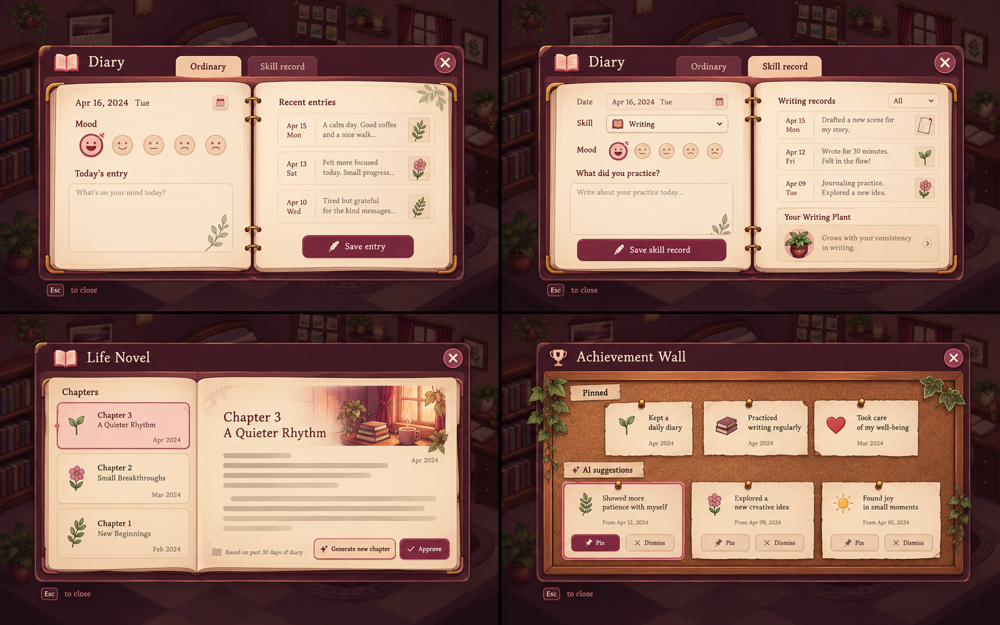

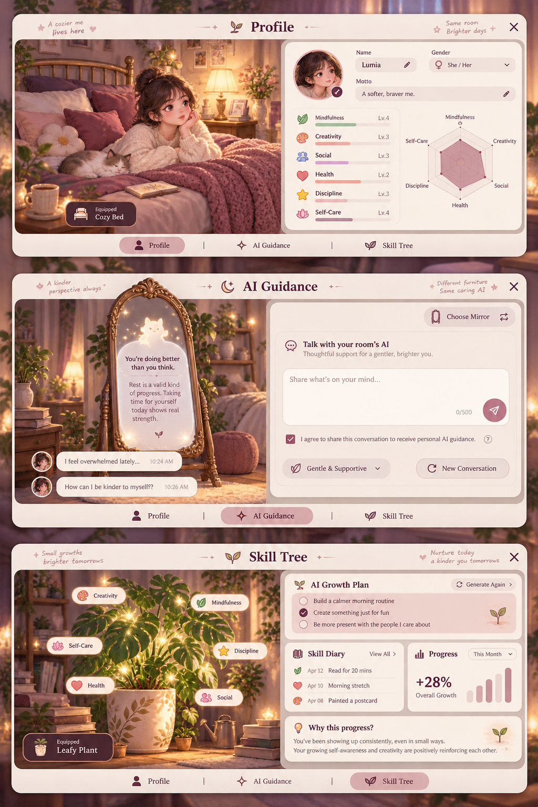

*These landscape images show the function-page design ideas, including AI Guidance in the Mirror.*

I started planning a short friend test of the Mirror. Would someone use it to reflect, begin a small action, or make a personal story they wanted to keep? A week of use might tell me more than one visit, though first I need a version friends can reach and an AI reply that works reliably. I compared OpenAI and Ollama again, including the cost of letting several people use the Mirror.

### 17 October 2026 — Rebuilding the function pages

The six pages now sit over the room in warm ivory and muted plum. Each has a header, a close button, and a main action. Diary shows writing and recent records, Profile has editable details and a radar view, and Life Novel shows its sources beside a draft. These are working panels, though I still want them to feel more like parts of the room.

Diary has date navigation, Mood choices, related Skills, recent entries, and Save. I added a Skill Record for practice, duration, difficulty, and an optional Diary link. Skill Tree puts skills beside their practice records. On the Achievement Wall I separated moments a person pins from suggestions made by AI. I am still working out what the main action should be in Profile and AI Guidance.

I changed my mind about Life Novel. I had imagined an automatic monthly story, but now the person chooses dates and exact Diary entries, reads and edits the draft, then approves the chapter. I do not want an AI suggestion quietly turning into a permanent memory. I also added a virtual joystick for phone users and checked the panels locally. The phone camera still needs work, and I need to see what people actually do with these pages.

### 18 October 2026 — The Crow becomes the AI companion

I decided that Little Crow should be the AI companion. Until now the Mirror held everyday AI guidance and the Crow belonged to the opening story. I moved conversation to the Crow and gave it a larger view. The Mirror stays in the mystery. The Crow can read saved room information when the person turns that option on.

I had considered Ollama on my own computer, but friends would lose access whenever I turned it off. For this web prototype I chose the OpenAI API and sent requests through a server route so the key stays out of the browser. I set GPT-5.4 mini (`gpt-5.4-mini`) as the text-generating LLM for Crow and the writing features. Crow's replies are meant to be short, and a cheaper model makes it easier to let friends try the site.

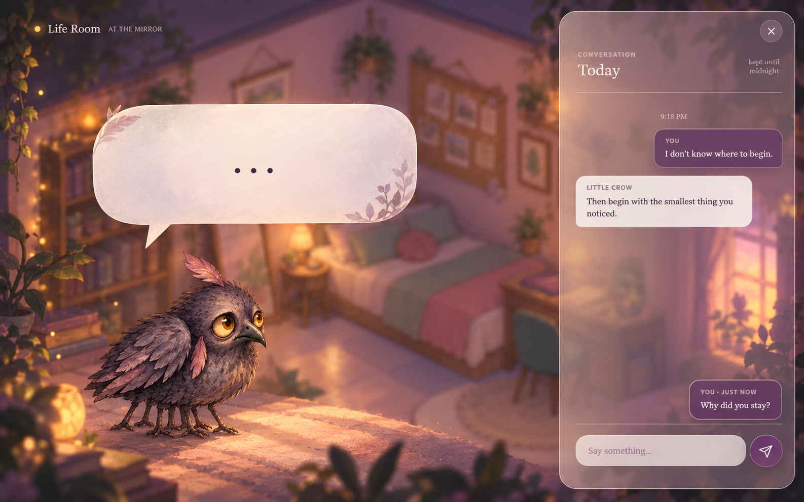

*A concept for Crow's conversation page. The working panel still needs more work.*

[Background and opening guidance](../game-version/basics/background.md)

The opening has grown too. The writers are connected to the past and future, with the player in the middle. “Eight” points toward the Crow's eight legs. The player now encounters Diary, Skill Tree, Profile, Achievement Wall, Life Novel, and Crow before the reveal. I want each stop to teach an action, and resetting the story must leave personal records alone.

### 19 October 2026 — Refining the Crow and the opening

I made another version of the characters. The girl has a plum dress and bow, and the boy has a brown vest and shorts. They both keep the brown hair and shoulder bag. I made front, back, and side movement sheets and tried several eight-legged Crows. The extra legs need to make sense when the story reveals them without making the Crow too strange to talk to. I also adjusted the room hints so players can find the next object.

  
  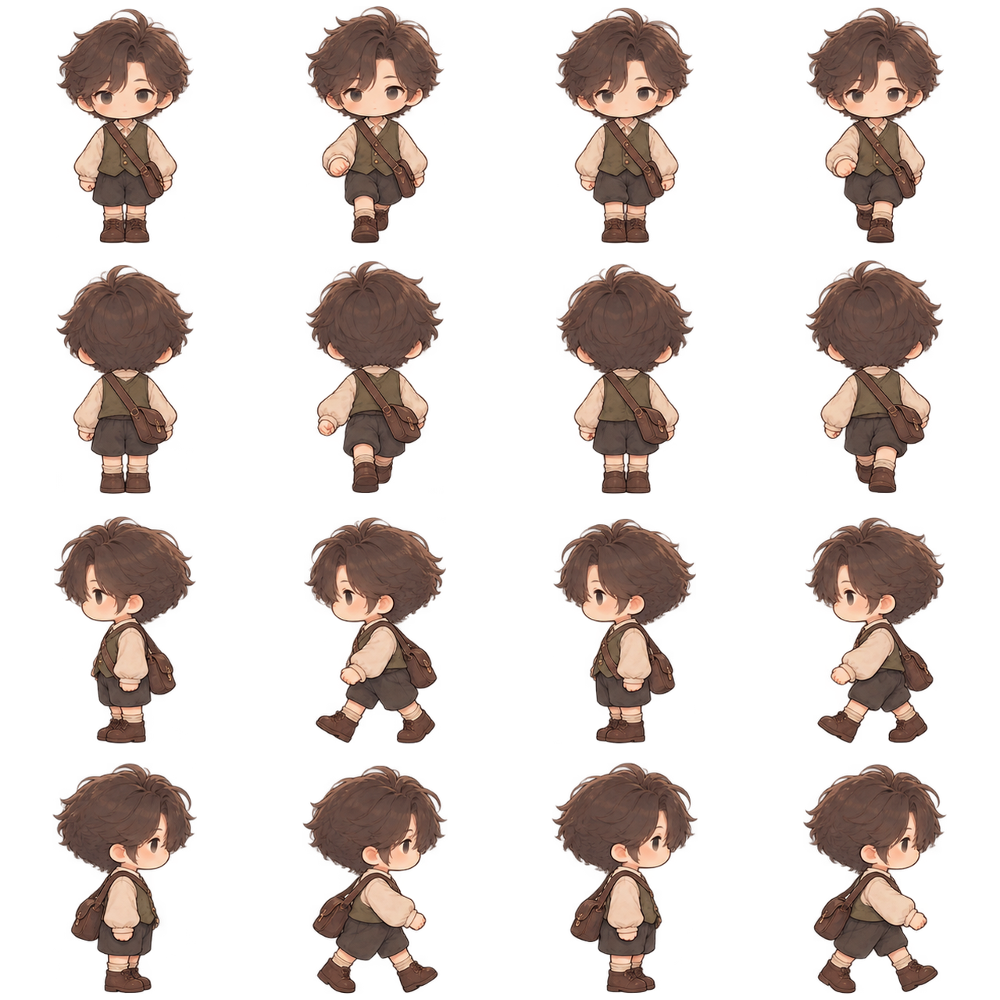

*Today's revised movement sheets.*

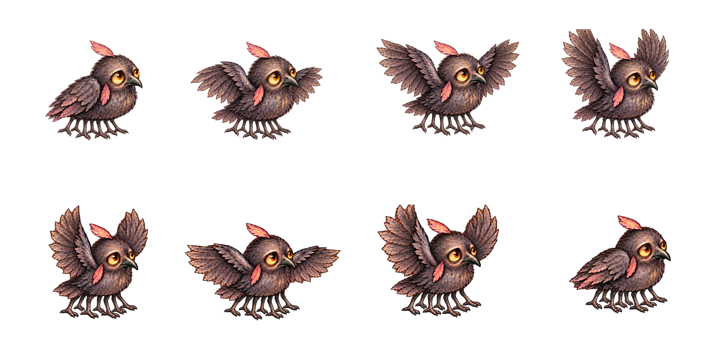

*The updated eight-legged Crow sprite sheet used for the opening.*

### 20 October 2026 — Improving phone navigation

I worked on the room camera and phone controls. Interaction prompts can be tapped, while a pinch zooms in and dragging moves around the enlarged room. I want someone without a keyboard to be able to finish the opening and use the room afterward.

### 21 October 2026 — Checking the Vercel phone preview

I opened the Vercel version on a phone. It took too long to load, so I lowered image quality and used WebP files. The faster preview looked blurry, which is noticeable when the room itself carries so much of the experience. I traced much of the loading delay to the furniture being split into separate image requests. I temporarily merged the background without changing the hotspots. I still want a clearer shared page.

[Phone preview showing the image-quality issue](../game-version/documents/mobile-preview-life-room.jpg)

### 21 October 2026 — The first survey answer

The first survey answer arrived. The respondent found some value in the introduction but said the text read like a puzzle. He tried all six functions and liked the Life Novel idea. I like leaving clues, though I may be asking people to work too hard just to learn what to do next.

### 23 October 2026 — Rewriting the final reveal

The last paragraph of the opening asked the player to take in too much at once. I spread the exchange between the past and future writers across three letters in the room. I also moved Profile closer to the bed and checked that the Crow's AI panel opens during the tutorial. I want a clue to lead to the right room action without having to explain the whole story at once.

### 25 October 2026 — What the first feedback showed

Four more questionnaire answers came in. One person skipped the opening, could not find the Crow, and did not get the response they expected when they tried to follow it. Someone else understood the idea better after saving a Diary entry and seeing the room change. A third would rather have just Diary and Crow than six functions. The fourth liked Diary's clean screen but worried about privacy and AI.

The Crow needs to be findable even if someone skips the story. I also want to keep that moment when a saved entry changes the room. It may be the quickest way to understand what this place does.

### 27 October 2026 — Looking across the first responses

I reviewed six more answers, bringing the total to 11. One person understood how Mood, Diary, AI chat, and a personal story fit together and liked Life Novel. Another liked the Crow but wanted richer media or more visible growth. A longer response said the notes were interesting but hard to follow, and that writing a full Diary entry immediately felt like a lot. Someone else understood the idea when the room changed after an entry. Another suggested a sample Diary entry.

I may need a much smaller first writing step and clearer clues. Most people have only visited once, so these answers tell me about that first encounter.

### 30 October 2026 — Sharpening the thesis question

I finished the Introduction of my thesis and went back through research on personal informatics, games, reflection, narrative, and AI companions. My earlier question had become too broad. Other applications do combine games and self-management. I am now asking how narrative, spatial elements, and an AI companion work together in this particular room to support reflection.

### 5 November 2026 — Preparing to discuss the project

The deadline is getting close. Before meeting my advisor again, I looked over the 11 survey answers and outlined another paper draft. People liked different parts of the room, Crow, and story, but some were confused by the opening or found the Diary too demanding at first. I have to make room for both reactions in the paper.

I also used Crow and Life Novel myself in ordinary situations and wrote down where they helped me think and where they got in the way. This is useful for finding design problems.

### 6 November 2026 — Keeping AI companionship in the research question

I talked with my advisor and still want the research to focus on AI companionship. I have been using Crow in Chinese, my first language. Sometimes I open it to share something happy, sometimes because I am stressed, and sometimes because I need help starting a skill exercise. I notice that I want a different kind of reply each time.

Crow can be warm and concise. When I only want to tell it something, though, another reflective question can feel tiring. Life Novel has its own problem, since the generated writing sometimes sounds like old Diary entries put together instead of a story I can recognise as mine. I wonder whether a companion that remembered more would make the room feel more familiar. I am unsure how much it should remember, or what a person would want to let it read.

I am still unsure how to show slow growth without pretending it can always be measured as a percentage. I also do not know whether talking with Crow would help anyone keep practising over time. For now, those are questions I can take into the next version and into longer testing.

### 13 November 2026 — Screenshots of the working pages

I captured the current pages with empty test records today. Diary, Life Novel, Profile, Skill Tree, and Achievement Wall are all there, although I still need to see how they feel with someone's own entries. I also have a phone view showing the room and virtual joystick.

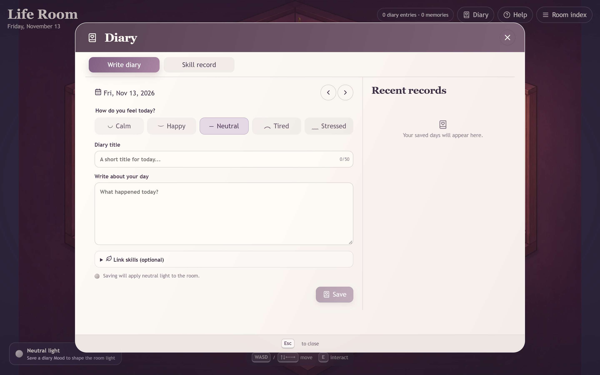

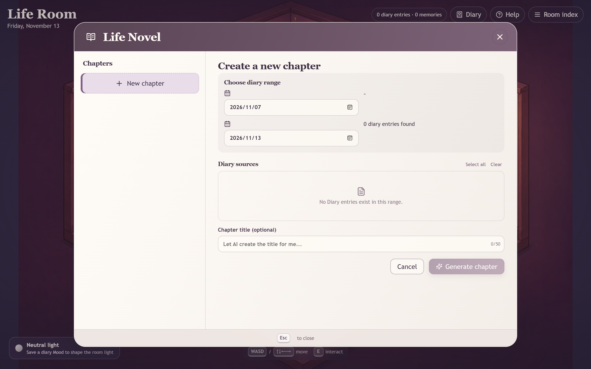

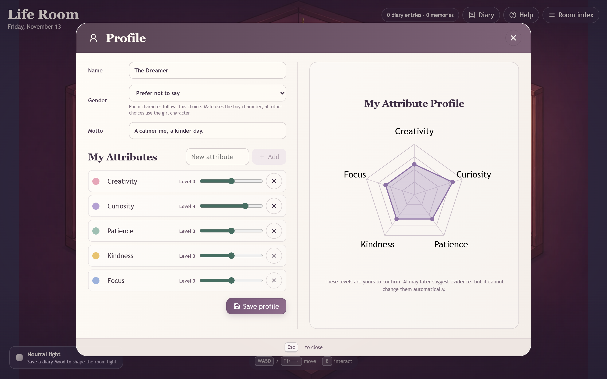

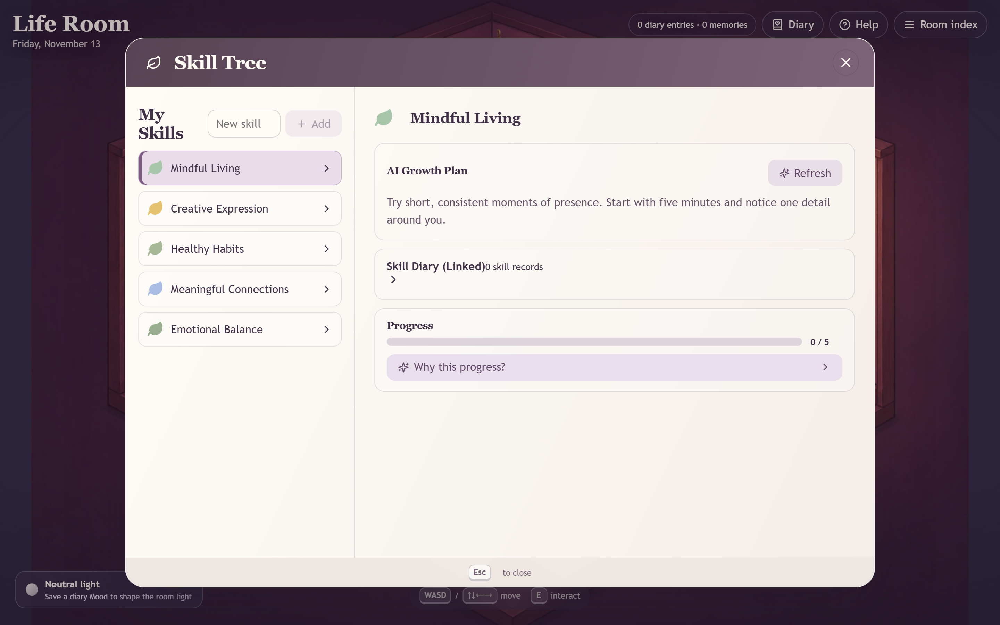

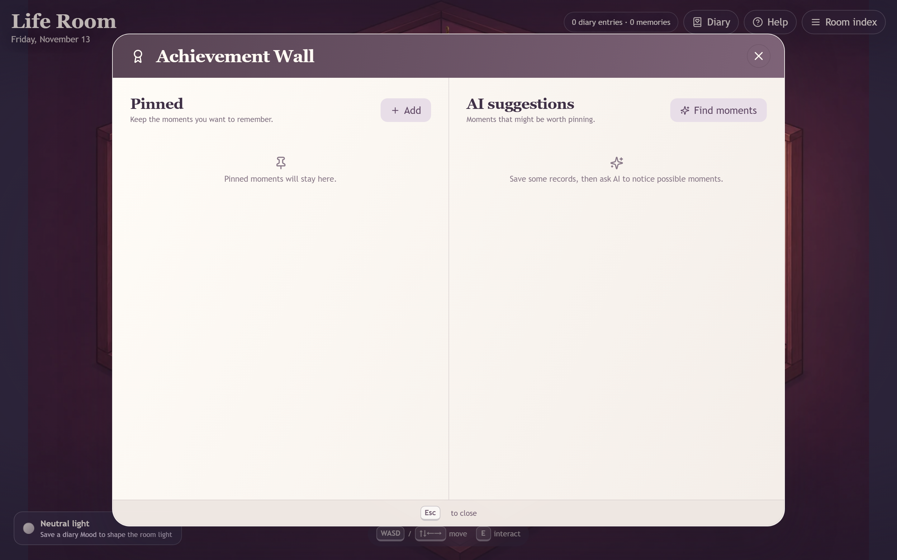

  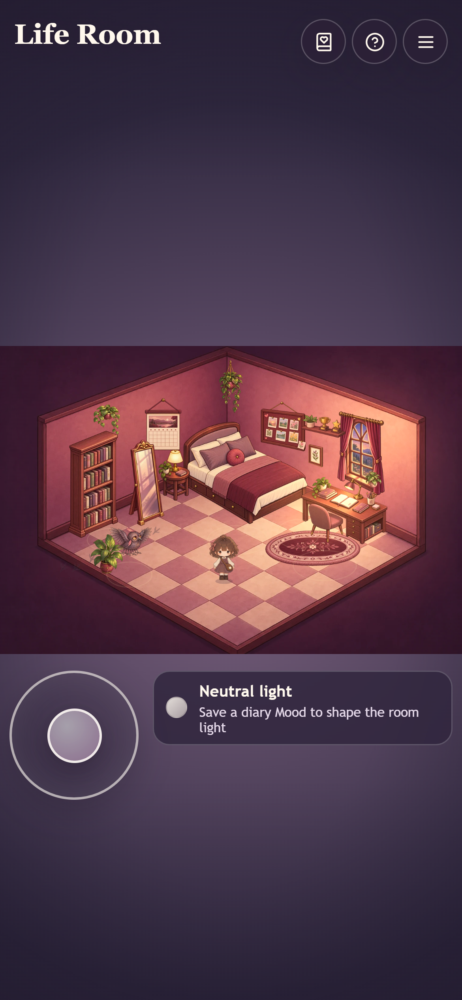

